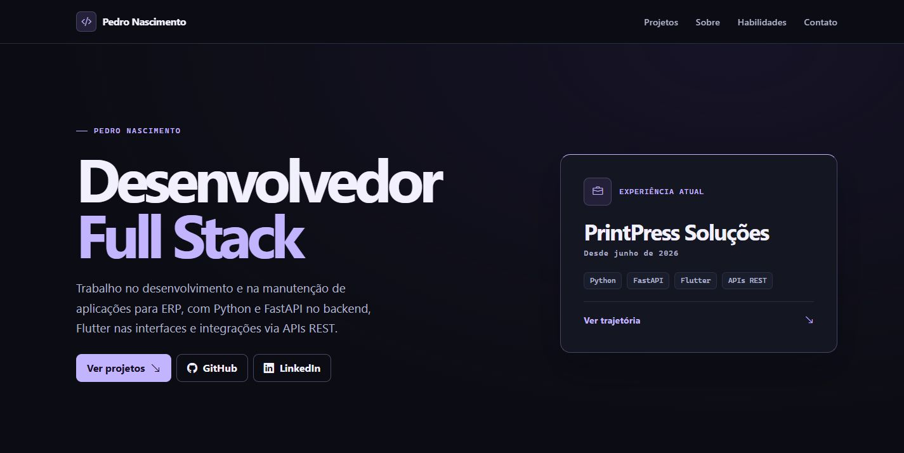
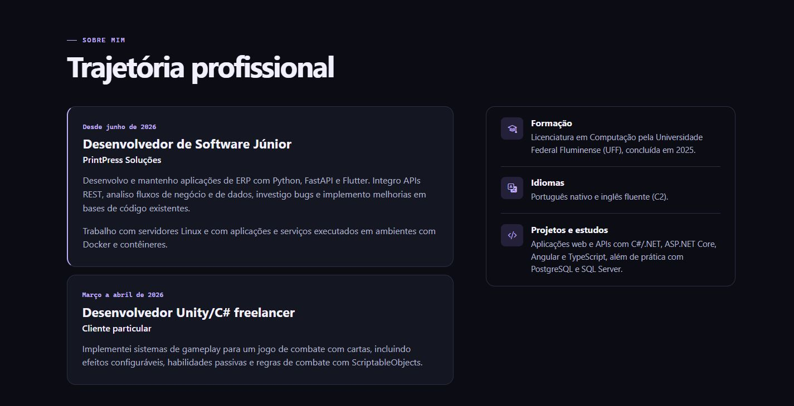
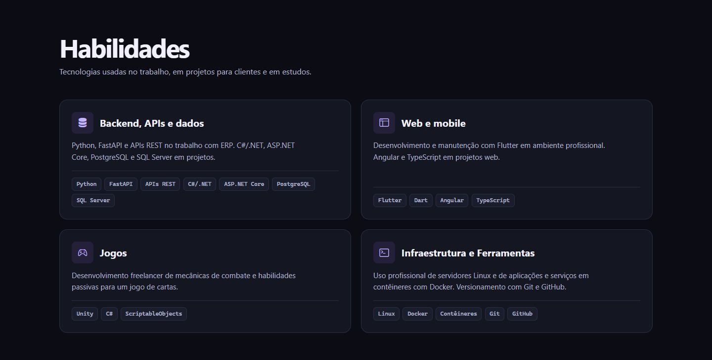
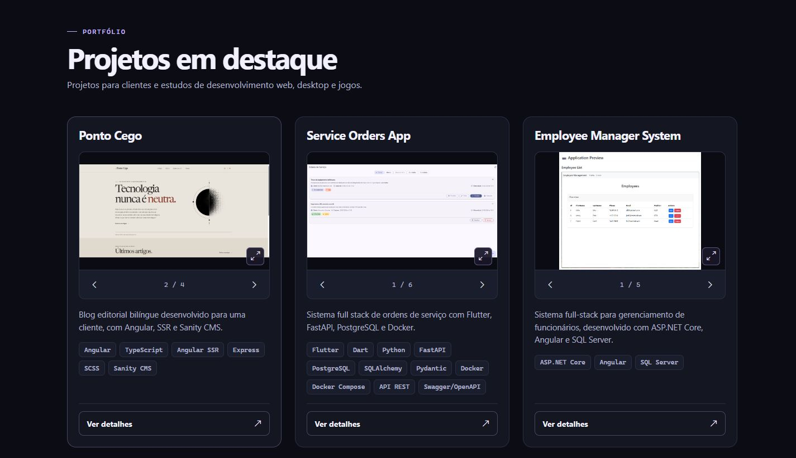
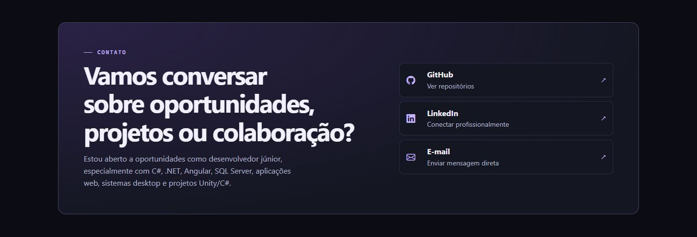

# PedroPortfolio

This project was generated using [Angular CLI](https://github.com/angular/angular-cli) version 21.2.12.

## Portfolio projects

This site showcases recent work, including **Service Orders App**, a full-stack Flutter, FastAPI, PostgreSQL and Docker project, alongside this portfolio website and other projects.

## Screenshots

### Página inicial



### Sobre mim



### Habilidades



### Projetos



### Contato



## Local environment

Use Node.js **24.22.1** (recorded in `.nvmrc`) and npm **11.13.0** (recorded in
`package.json`). Angular 21 supports Node.js `^20.19.0`, `^22.12.0` or `^24.0.0`;
Node.js 26 is outside its supported range. See the
[Angular compatibility table](https://angular.dev/reference/versions).

Select the Node.js version with your version manager before installing dependencies.
For nvm-windows, run `nvm install 24.22.1` and `nvm use 24.22.1`.
Check `node --version` and `npm --version`; if needed, select the npm version with
`npm install --global npm@11.13.0`.

Install the exact dependency versions from the existing lockfile:

```bash
npm ci
```

The application uses standalone Angular components, Bootstrap, and Vitest. No backend
service or environment variables are required for local development.

## Development server

To start a local development server, run:

```bash
npm start
```

Once the server is running, open your browser and navigate to `http://localhost:4200/`. The application will automatically reload whenever you modify any of the source files.

## Code scaffolding

Angular CLI includes powerful code scaffolding tools. To generate a new component, run:

```bash
ng generate component component-name
```

For a complete list of available schematics (such as `components`, `directives`, or `pipes`), run:

```bash
ng generate --help
```

## Building

To build the project run:

```bash
npm run build
```

This will compile your project and store the build artifacts in the `dist/` directory. By default, the production build optimizes your application for performance and speed.

## Running unit tests

To execute unit tests with the [Vitest](https://vitest.dev/) test runner, use the following command:

```bash
npm test
```

For a single run without watch mode, use `npm test -- --watch=false`.

## Running end-to-end tests

No end-to-end runner or `e2e` target is configured in this repository.

## Additional Resources

For more information on using the Angular CLI, including detailed command references, visit the [Angular CLI Overview and Command Reference](https://angular.dev/tools/cli) page.
